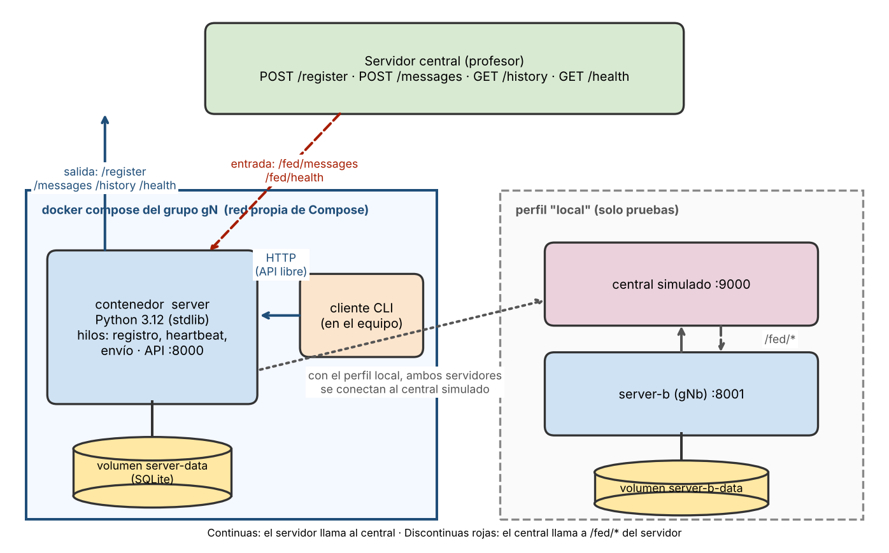

# Arquitectura

- **Contenedores:** `server` (servidor del grupo, puerto 8000). Con el perfil `local` se añaden
  `central` (central simulado, 9000) y `server-b` (segundo servidor `gNb`, publicado en 8001).
- **Red:** Compose crea una red propia; los contenedores se ven por nombre de servicio
  (`central`, `server`, `server-b`). En la sesión de interoperabilidad el central alcanza al
  servidor por la `PUBLIC_URL` (IP del equipo en la red de la sala).
- **Volúmenes:** `server-data` y `server-b-data` guardan la base SQLite
  (`users`, `messages`, `pending`). `docker compose restart` no pierde nada.
- **Topología:** estrella; los servidores de grupo solo hablan con el central.

## Módulos del servidor

| Módulo | Responsabilidad |
| --- | --- |
| `config.py` | Toda la configuración sale de variables de entorno. |
| `clock.py` | Reloj de Lamport: `tick()`, `observe()`, `restore()`. |
| `db.py` | SQLite: usuarios, mensajes (id = clave primaria → deduplicación), cola `pending`. |
| `federation.py` | Hilos de registro, heartbeat y envío; `ingest()` y `recover_history()`. |
| `main.py` | API local + API de federación (`/fed/*`). |

## Flujo de un mensaje

1. `POST /messages` → `tick()`, UUID, guardar en `messages` y `pending` (una transacción). Log `LOCAL`.
2. Hilo de envío: `POST /messages` al central → `SENT`. Si 5xx/timeout → `RETRY` con backoff; si 4xx → `DROP`.
3. El central reenvía a los demás con `POST /fed/messages`. El receptor valida, descarta repetidos (`DUP`) y aplica `max(local, recibido)+1` (`RECV`).

## Caída y recuperación

1. `GET /health` falla `HEARTBEAT_MAX_FAILS` veces → `CENTRAL_DOWN`; los mensajes locales siguen entrando en `pending`.
2. El central responde de nuevo → `CENTRAL_UP`: re-registro, `GET /history?since=…` (`HISTORY`) y vaciado de la cola.
3. Si es el propio servidor el que se cayó: al arrancar restaura el reloj, y como aún no se ha puesto al día, pide el historial en su primer heartbeat.
